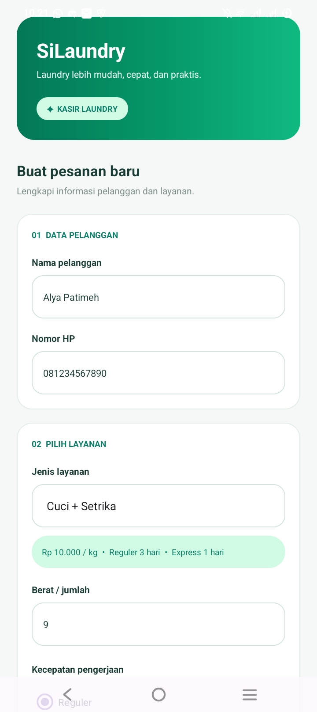

SiLaundry - Aplikasi Kasir Laundry

SiLaundry merupakan aplikasi kasir laundry berbasis Android yang dirancang untuk membantu proses pencatatan pesanan, penghitungan biaya, dan pembuatan nota pembayaran secara lebih mudah, cepat, dan praktis.

🧺 Fitur & Tampilan Aplikasi

1. Input Pesanan

Digunakan untuk memasukkan informasi pelanggan dan menentukan layanan laundry.
[Halaman Input Pesanan]
(screenshot-input.jpeg)

2. Pilihan Layanan

Menyediakan beberapa jenis layanan laundry, pilihan kecepatan pengerjaan, serta layanan tambahan.

3. Perhitungan Biaya

Menghitung total biaya pesanan secara otomatis berdasarkan layanan dan pilihan tambahan.

4. Nota Pembayaran

Menampilkan informasi pelanggan, rincian biaya, total pembayaran, dan estimasi waktu penyelesaian.

5. Berbagi Nota

Memudahkan pengguna untuk membagikan nota pembayaran.
[Halaman Nota Pembayaran]
(screenshot-nota.jpeg)

🛠️ Teknologi & Tools

- Bahasa Pemrograman: Kotlin
- IDE: Android Studio
- Layout: XML
- Platform: Android

🚀 Cara Menjalankan Aplikasi

1. Install Android Studio.
2. Clone atau download repository SiLaundry.
3. Buka folder project melalui Android Studio.
4. Tunggu proses Gradle Sync hingga selesai.
5. Jalankan aplikasi menggunakan emulator atau perangkat Android.

## 📸 Tampilan Aplikasi

### 1. Halaman Input

### 2. Halaman Nota

📱 Developer

Dikembangkan sebagai project aplikasi Android.
